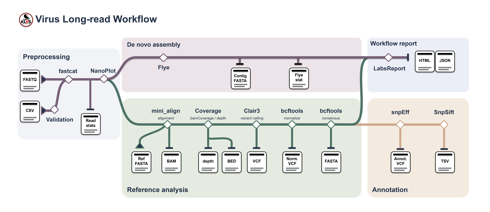

# wf-virus-longread

Long-read viral genome analysis with reference-based variant calling, consensus generation, optional annotation, or de novo contig assembly.

## Introduction

`wf-virus-longread` processes existing Oxford Nanopore FASTQ reads in Nextflow and can be imported into EPI2ME Desktop. Choose the analysis mode that fits your input:

- **De novo:** assemble reads with Flye and return contigs, assembly statistics and read-to-contig coverage.
- **Reference-based:** align reads to a user-selected reference, call variants with Clair3, and generate a consensus with optional low-coverage masking.
- **Optional reference annotation:** add snpEff variant effects and a tabular summary using a database that matches the reference.

Both modes produce read QC, sample metadata and an interactive HTML report. De novo analysis stops at Flye contigs; the additional alignment measures coverage without polishing or changing those contigs. Basecalling itself is not performed.



The workflow was developed and tested with VZV inputs. Using another viral reference requires a suitable reference sequence and, when annotation is enabled, a matching snpEff database. See [VALIDATION.txt](VALIDATION.txt) for the tests performed and their scope.

## Run the workflow

### EPI2ME Desktop

Import the repository into EPI2ME Desktop:

```text
https://github.com/klvsjeju/wf-virus-longread
```

Select **Run locally**, choose a FASTQ file or folder, and configure the analysis:

1. Leave **Reference-based assembly** disabled for de novo contigs, or enable it and select an uncompressed reference FASTA.
2. Optionally provide a sample sheet or sample name.
3. Adjust the advanced options as needed. The minimum read length defaults to 1,000 bp for de novo analysis.
4. Enable reference annotation only when a matching snpEff database is available.
5. Start the analysis and inspect the report, files and logs in EPI2ME.

### Command line

The workflow requires Nextflow **23.04.2 or later** and access to a Docker daemon for its standard profile. The configured public images are downloaded when they are not already cached; no custom image build is required.

Run from this repository directory:

```bash
# De novo contigs; reads shorter than 1,000 bp are excluded by default.
nextflow run . -profile standard --fastq /path/to/reads --out_dir output

# Reference-based variants and consensus, without annotation.
nextflow run . -profile standard \
  --fastq /path/to/reads \
  --reference_based_assembly \
  --reference /path/to/reference.fa \
  --out_dir output

# Alternatively, edit the example paths and use a parameter file.
nextflow run . -profile standard -params-file params.reference.example.json
```

The default is **4 threads per task** and a **4 GB task memory request**. Total resource use depends on concurrent tasks and input data; these defaults are not a measured minimum for every dataset. The `local` profile disables Docker and requires the analysis tools and report dependencies to be installed separately.

## Input example

The workflow accepts `.fastq` or `.fq` files, either uncompressed or gzip-compressed. It supports three input layouts:

```text
1. One file                 2. One sample folder       3. Multiple sample folders

reads.fastq.gz              sample_A/                  run/
                            ├── reads_01.fastq.gz     ├── barcode01/
                            └── reads_02.fastq.gz     │   ├── reads_01.fastq.gz
                                                      │   └── reads_02.fastq.gz
                                                      └── barcode02/
                                                          └── reads_01.fastq.gz
```

For a single file or flat folder, `--sample` sets the sample name. If it is empty, the workflow derives a name from the file or folder. For multiplex input, subfolder names identify samples, and `--sample` selects a matching sample rather than renaming every folder. Only one subdirectory level is supported; do not mix top-level FASTQ files with sample subfolders.

### Sample sheets and names

An optional `--sample_sheet` CSV maps barcode folders or alias folders to final sample names:

```csv
barcode,alias
barcode01,VZV01
barcode02,VZV02
```

For this example, a folder named either `barcode01` or `VZV01` is assigned the final name `VZV01`. Supplying both folders for the same row is an error. Folders absent from the sheet are ignored with a warning; sheet rows without corresponding input are listed as missing in the report. Single-file and flat-folder inputs use their own naming rule rather than the sheet.

Barcode values must start with `barcode` followed by at least two digits, all of the same length. Barcode and alias values must be unique; aliases must not start with `barcode`. Spaces in final names become underscores. Final names must start with a letter or digit and contain only letters, digits, `_`, `.` or `-`. The shared output names `execution`, `results.json` and `wf-virus-longread-report.html` are reserved, case-insensitively.

### Basecalling model

Leave the manual basecalling model unset for automatic detection from fastcat statistics. When needed, header fallback checks explicit model tags and versioned `RG:Z:` read-group metadata. A manual selection overrides detection; mixed detected models otherwise cause an error.

Reference mode selects a compatible Clair3 1.x checkpoint from the detected model. It uses a matching preinstalled model when available, or downloads a supported model automatically. Downloading requires network access. Unsupported or unknown models require a correct manual selection or compatible custom checkpoint; the workflow does not guess an approximate match. De novo analysis can run without basecaller tags.

## Pipeline overview

### 1. Prepare reads and generate QC

Fastcat concatenates sample reads, applies the de novo minimum-length filter, and collects input and retained-read statistics. Threaded bgzip compresses the resulting FASTQ. NanoPlot then generates QC from those retained reads.

Input counts, retained counts and reads excluded by length are reported separately. In de novo mode, `min_read_length=1000` retains reads of at least 1,000 bp; `0` disables the filter. Reference-based analysis ignores this setting. If no reads survive, ingestion stops with guidance to lower the threshold.

### 2a. De novo assembly

Flye runs with the fixed `--nano-hq` input mode and the selected genome size and additional arguments. The workflow returns a sample-prefixed contig FASTA and the Flye output directory.

For report QC, the retained reads are mapped back to those contigs. Primary mapped alignments meeting `min_mapq` are used to calculate total, forward and reverse depth. This step adds coverage information without altering the assembly. No downstream Medaka or Clair3 polishing is performed.

### 2b. Reference-based analysis

The selected reference is indexed, reads are aligned using `mini_align`, and samtools removes unmapped, secondary, supplementary and low-MAPQ alignments. Clair3 performs ONT haploid-sensitive variant calling using the selected checkpoint.

Bcftools normalizes the merged calls and extracts PASS records. The full normalized VCF supplies report variant statistics. The PASS VCF supplies the consensus, together with the selected consensus options and optional low-coverage mask. Total and strand-specific depth are calculated using the configured depth options.

### 3. Optional variant annotation

When `run_annotation` is enabled, snpEff annotates the **full normalized VCF**, including non-PASS records. SnpSift extracts a TSV with positions, alleles, genes, effects, impacts, genotype, depth, allele fraction and HGVS fields.

Provide all three annotation settings:

| Setting | Select or enter |
| --- | --- |
| `snpeff_config` | The `snpEff.config` file that defines the database. |
| `snpeff_data` | The database root directory containing `<snpeff_db>/snpEffectPredictor.bin`. |
| `snpeff_db` | The database identifier used in the configuration and data subfolder. |

The database must match the reference coordinates and contig names. Annotation is optional and is not run in de novo mode.

## Main options

EPI2ME groups the launch settings into Input options, Sample options, Advanced option, Reference annotation and Miscellaneous option. Its Nextflow configuration area is supplied by Desktop.

| Parameter | Default | Purpose |
| --- | --- | --- |
| `fastq` | Required | FASTQ file, flat folder or parent of sample folders. |
| `sample_sheet` | Unset | Optional barcode-to-alias CSV for multiplex input. |
| `sample` | Unset | Name a single input, or select a multiplex sample. |
| `reference_based_assembly` | `false` | Enable reference analysis instead of de novo assembly. |
| `reference` | Unset | User-provided reference FASTA; required in reference mode. |
| `min_read_length` | `1000` | De novo minimum read length in bp; `0` disables filtering. |
| `flye_genome_size` | `125000` | Estimated genome size in bp for Flye. |
| `override_basecaller_cfg` | Unset | Manually identify the model used to basecall the existing reads. |
| `min_mapq` | `20` | Minimum MAPQ for retained reference alignments and de novo coverage QC. |
| `min_coverage` | `30` | Clair3 minimum coverage. |
| `mask_depth` | `0` | Mask positions below this depth in the reference consensus; `0` disables the mask. |
| `run_annotation` | `false` | Enable snpEff and SnpSift in reference mode. |
| `threads` | `4` | Threads allocated per task. |
| `out_dir` | Automatic | Output root; see the folder layout below. |

### Manual additional options

Enter extra argument strings under Advanced option. Leave them empty to retain the tool's workflow defaults.

| Setting | Tool | Example |
| --- | --- | --- |
| `flye_opts` | Flye | `--meta --iterations 2 --asm-coverage 50` |
| `mask_depth_opts` | samtools depth | `-q 15 -Q 20` |
| `consensus_opts` | bcftools consensus | `--include 'FORMAT/AF>0.5'` |

The consensus example applies only variants with **AF strictly greater than 50%**. It requires numeric `FORMAT/AF` values and filters variants applied to the consensus, not the published VCF. Excluded variants leave the reference base unless masked separately.

For example, `mask_depth=30` with `mask_depth_opts="-q 15 -Q 20"` masks positions below 30x after the selected base- and mapping-quality requirements. Depth defaults retain `-aa -J`. Region-restricting options such as `-r` or `-b` leave positions outside the selected region untreated by this mask. Depth options cannot restore reads removed during alignment.

On the command line, quote the complete argument string:

```bash
nextflow run . -profile standard --fastq /path/to/reads \
  --min_read_length 2000 --flye_opts '--meta --iterations 2'
```

Workflow-managed arguments such as input/output paths, reference, threads, genome size and mask paths must use their dedicated settings. Quoted argument values are supported; shell expansion, pipes and redirects are not executed. Files named inside additional arguments are not automatically staged into containers.

## Output folder layout

All per-sample results are grouped directly under `<out_dir>/<sample>/`:

```text
<out_dir>/
├── <sample>/
│   ├── alignment/             # Reference BAM/index and total/fwd/rev depth
│   ├── clair3/                # Reference VCFs, consensus, optional mask and statistics
│   ├── annot/                 # Optional reference annotation
│   ├── model_selection.json   # Reference Clair3 model provenance
│   ├── <sample>.contigs.fasta  # De novo contigs
│   ├── flye/                  # De novo assembly outputs
│   ├── coverage/              # De novo total/fwd/rev depth against contigs
│   ├── qc/NanoPlot/
│   └── metadata/
│       ├── basecaller.json
│       └── fastcat_stats/
├── wf-virus-longread-report.html
├── results.json
└── execution/
```

Only folders relevant to the selected mode are created. If `out_dir` is unset, the workflow writes to `analysis_result` inside the selected input directory, or beside a single input FASTQ file. EPI2ME folder outputs are registered in [output_definition.json](output_definition.json) for its native folder handling.

### Reference VCFs and consensus

| File | Contents / use |
| --- | --- |
| `<sample>_merge_output.vcf.gz` | Merged Clair3 calls retained for provenance. |
| `<sample>_norm.vcf.gz` | All normalized calls, including non-PASS records; used for report statistics and annotation. |
| `<sample>_norm.pass.vcf.gz` | PASS calls used to generate the consensus. |
| `<sample>_annot.vcf` | Optional snpEff-annotated normalized calls, stored in `annot/`. |
| `<sample>_consensus.fa` | Reference-guided consensus. |

VCF indexes use the matching filename prefix. Pileup/full-alignment intermediate VCFs and their indexes are omitted from published results. A single-reference consensus header is `><sample>`; additional records use `><sample>|contig2`, `><sample>|contig3`, etc. to preserve unique identifiers.

## Results and report

The report uses EPI2ME Labs components with sample dropdowns, searchable tables and interactive plots. Sections depend on the analysis:

| Report section | When shown | Contents |
| --- | --- | --- |
| Sample summary | Always | Sample names, input/retained counts, excluded short reads and sequence totals; missing inputs are listed separately. |
| Read summary | Usable read statistics exist | Read quality, length and base yield from fastcat histograms. |
| Assembly summary statistics | De novo | Contig length, coverage, circular/repeat status and multiplicity. |
| Variant calling | Reference-based | Counts from the full normalized VCF, Ts/Tv, substitution heatmap and indel length histogram. |
| Genome coverage | Both modes | Total/fwd/rev depth plots and coverage statistics, including 30x/50x percentages. |
| Consensus and masking | Reference-based | Consensus totals and mask links. |
| Variant annotations | Annotation enabled | snpEff impact/effect summaries and a TSV preview with a full-file link. |
| Models, files and execution | Common | Model provenance, result links, runtime information and container settings. |

Coverage statistics use all assessed positions; plots summarize at most 500 bins per reference/contig and display the 20 longest sequences. Full depth files remain available. Missing coverage produces an explanatory message. Annotation previews contain at most 500 rows per sample; the complete TSV is linked.

EPI2ME Desktop provides the following tabs:

| Tab | Contents |
| --- | --- |
| Details | Run status and launch settings. |
| Reports | Workflow HTML report, with separate NanoPlot and Nextflow reports where available. |
| Files | Sample outputs and folders described in the output definition. |
| Logs | Workflow and process logs; the task trace is also in `execution/trace.tsv`. |

Keep the output directory structure intact when moving results so relative report links continue to work. If the embedded viewer restricts file links, use the Files tab. The aggregate report waits for analysis and QC; a failed process can prevent its generation.

## Troubleshooting

- **A new option is missing in EPI2ME:** update the installed workflow, including its schema and scripts, then reopen the launch settings. The displayed version alone does not distinguish commits that share version `0.3.3`.
- **No reads remain after length filtering:** lower `min_read_length` or set it to `0` for de novo analysis.
- **The basecaller is unknown:** inspect the FASTQ header and `<sample>/metadata/basecaller.json`, or select the model that was actually used.
- **Clair3 model preparation fails:** check model support and network access, or supply compatible custom CLI checkpoints. No approximate automatic model fallback is used.
- **Annotation fails:** confirm that `snpeff_config`, `snpeff_data` and `snpeff_db` refer to the same database and match the reference.

The shared input handling and report structure were adapted with reference to [wf-bacterial-genomes](https://github.com/epi2me-labs/wf-bacterial-genomes). This viral workflow uses Clair3 and snpEff and does not include the bacterial workflow's MLST, AMR, species identification or plasmid analyses. Implementation and execution checks are recorded in [VALIDATION.txt](VALIDATION.txt).
